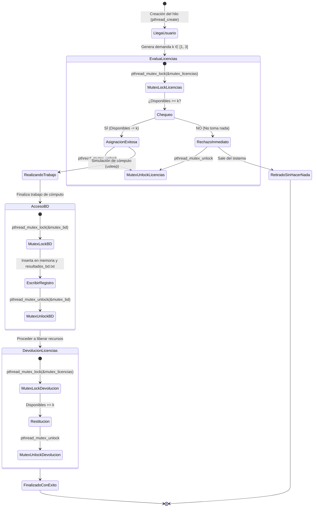

# INFORME TÉCNICO - LABORATORIO DE SISTEMAS OPERATIVOS
## Sincronización y Concurrencia: Control de Licencias en Centro de Cómputos

**Universidad Nacional del Sur (UNS)**  
**Departamento de Ciencias e Ingeniería de la Computación**  
**Carreras:** Ingeniería en Computación / Ingeniería en Sistemas de Información  
**Asignatura:** Sistemas Operativos  

---

## 1. Introducción y Planteo del Problema

El presente informe documenta el diseño, análisis teórico, implementación en lenguaje C y verificación experimental de la solución al problema planteado en el **Laboratorio de Sistemas Operativos**:

### Consigna Oficial:
> "Un centro de cómputos controla el uso de licencias de un software especializado:
> - Se disponen un total de **20 licencias**.
> - Cada usuario puede requerir entre **1 y 3 licencias**.
> - Si consigue las licencias requeridas, realiza su trabajo.
> - Al terminar guarda sus resultados en una **base de datos compartida** y por último **libera las licencias utilizadas**.
> - **Si no puede conseguir todas las licencias requeridas, se retira sin hacer nada.**
>
> a) Implemente el problema utilizando hilos y las herramientas de sincronización que considere adecuadas.  
> b) Explique el modelo realizado y justifique la elección de las herramientas elegidas."

---

## 2. Análisis del Problema y Requisitos Críticos

Del enunciado se desprenden restricciones de concurrencia fundamentales:

1. **Recurso Finito y Compartido:** Existen exactamente 20 unidades de un recurso homogéneo (licencias).
2. **Demanda Heterogénea:** Cada hilo usuario solicita $k \in \{1, 2, 3\}$ licencias de forma aleatoria.
3. **Semántica "Todo o Nada" (No Bloqueante / All-or-Nothing):**
   - El usuario solo puede continuar si obtiene **la totalidad** de las licencias solicitadas en un único instante atómico.
   - Si en el momento de la consulta hay menos licencias disponibles que las solicitadas, el usuario **no debe bloquearse a esperar ni retener licencias parciales**; debe desistir inmediatamente y retirarse sin realizar trabajo.
4. **Persistencia Concurrente en Base de Datos Compartida:**
   - Todo usuario que finalice su cómputo debe registrar sus resultados en una base de datos común. Al ser una sección crítica compartida, múltiples escrituras simultáneas podrían provocar corrupción de memoria, entrelazado de datos (*race conditions*) o pérdida de registros.
5. **Orden Estricto de Liberación:**
   - El enunciado prescribe un orden temporal ineludible:
     $$\text{Adquirir licencias} \longrightarrow \text{Computar} \longrightarrow \text{Escribir en BD} \longrightarrow \text{Liberar licencias}$$
6. **Conservación del Invariante del Sistema:**
   - En todo momento debe cumplirse:
     $$\text{Licencias Disponibles} + \sum_{i \in \text{Activos}} \text{Licencias Asignadas}_i = 20$$
   - Al finalizar todos los hilos, las licencias disponibles deben volver a ser exactamente 20 (sin fugas de recursos).

---

## 3. Inciso a) Modelo Implementado y Arquitectura de la Solución

### 3.1. Arquitectura General y Flujo de Estados

El sistema fue modelado utilizando la biblioteca estándar **POSIX Threads (`pthread`)** en lenguaje C (`centro_computos.c`). Cada usuario es un hilo independiente (`pthread_t`) que transiciona por los siguientes estados:



### 3.2. Estructura de Datos y Primitivas de Sincronización

```c
#define TOTAL_LICENCIAS         20
#define MIN_LICENCIAS_REQ       1
#define MAX_LICENCIAS_REQ       3
#define ARCHIVO_BD              "resultados_bd.txt"

// Estado global de licencias
static int licencias_disponibles = TOTAL_LICENCIAS;

// Cerrojos de granularidad fina
static pthread_mutex_t mutex_licencias = PTHREAD_MUTEX_INITIALIZER;
static pthread_mutex_t mutex_bd        = PTHREAD_MUTEX_INITIALIZER;
static pthread_mutex_t mutex_pantalla  = PTHREAD_MUTEX_INITIALIZER;
```

### 3.3. Algoritmo Atómico de Adquisición ("Todo o Nada")

```c
int solicitar_licencias(int id_usuario, int cant_requerida) {
    int exito = 0;
    pthread_mutex_lock(&mutex_licencias);

    if (licencias_disponibles >= cant_requerida) {
        licencias_disponibles -= cant_requerida;
        exito = 1;
        // Registro de log exitoso...
    } else {
        // No hay suficientes: RECHAZO INMEDIATO SIN ESPERAS
        exito = 0;
        // Registro de log de rechazo...
    }

    pthread_mutex_unlock(&mutex_licencias);
    return exito;
}
```

### 3.4. Persistencia en la Base de Datos Compartida

La base de datos se modeló en memoria como un arreglo de estructuras `RegistroBD` y paralelamente se persiste en un archivo de texto en disco (`resultados_bd.txt`):

```c
void guardar_en_base_de_datos(int id_usuario, int licencias_usadas, int tiempo_ms, const char *resultado_calculo) {
    pthread_mutex_lock(&mutex_bd);

    // 1. Inserción en memoria compartida
    if (total_registros_bd < MAX_REGISTROS) {
        RegistroBD *reg = &base_de_datos[total_registros_bd++];
        reg->id_usuario = id_usuario;
        reg->licencias_utilizadas = licencias_usadas;
        reg->tiempo_computo_ms = tiempo_ms;
        strncpy(reg->resultado, resultado_calculo, sizeof(reg->resultado) - 1);
        obtener_tiempo_actual(reg->timestamp, sizeof(reg->timestamp));
    }

    // 2. Persistencia en archivo común
    FILE *archivo = fopen(ARCHIVO_BD, "a");
    if (archivo != NULL) {
        char tiempo[32];
        obtener_tiempo_actual(tiempo, sizeof(tiempo));
        fprintf(archivo, "[%s] Registro #%d | Usuario: %02d | Licencias: %d | Duración: %d ms | Resultado: %s\n",
                tiempo, total_registros_bd, id_usuario, licencias_usadas, tiempo_ms, resultado_calculo);
        fclose(archivo);
    }

    pthread_mutex_unlock(&mutex_bd);
}
```

---

## 4. Inciso b) Justificación Teórica y Técnica de las Herramientas Elegidas

### 4.1. ¿Por qué Mutex (`pthread_mutex_t`) y NO Semáforos Contadores (`sem_t`) para las Licencias?

Una tentación habitual en problemas con $N$ recursos idénticos es inicializar un semáforo contador POSIX en 20 (`sem_init(&sem, 0, 20)`). **Sin embargo, para este problema en particular, el uso de semáforos estándar es un grave error de diseño**, debido a las siguientes razones técnicas:

| Aspecto | Semáforo Contador (`sem_t`) | Mutex + Variable Entera (`pthread_mutex_t`) [Elegido] |
| :--- | :--- | :--- |
| **Atomicidad en pedidos múltiples ($k > 1$)** | No existe en POSIX una primitiva `sem_wait_n(&sem, k)`. Requiere invocar `sem_wait()` en un bucle $k$ veces. | La verificación `licencias_disponibles >= k` y su decremento ocurren en **una única operación indivisible**. |
| **Riesgo de Interbloqueo (*Deadlock*)** | **Alto:** Si hay 2 licencias libres y un usuario pide 3, tomaría 2 con éxito y se bloquearía en la 3ra, reteniendo recursos que otros hilos podrían usar (*Hold and Wait*). | **Nulo:** Jamás se asignan recursos parciales. O se obtienen las $k$ licencias o no se retiene ninguna. |
| **Cumplimiento de la consigna "Se retira sin hacer nada"** | `sem_trywait()` evalúa de a 1 unidad. Si tiene éxito en la 1ra pero falla en la 2da, debe deshacer invocando `sem_post()`, creando ventanas de inconsistencia y carreras críticas. | Si no alcanza el total, el hilo simplemente sale de la sección crítica sin modificar el contador y finaliza inmediatamente. |

> **Conclusión:** El par `pthread_mutex_t` junto con una variable de estado entera `licencias_disponibles` es la única solución que garantiza la propiedad **Todo o Nada (All-or-Nothing)** de forma completamente segura, portable y limpia.

---

### 4.2. Granularidad Fina de Cerrojos (*Fine-Grained Locking*)

Se implementó una separación estricta entre los recursos protegidos:

1. **`mutex_licencias`:** Protege exclusivamente las operaciones sobre el contador entero de licencias. La sección crítica dura apenas unos pocos nanosegundos (una comparación y una resta o suma).
2. **`mutex_bd`:** Protege exclusivamente la estructura de la base de datos y la operación de E/S a disco (`fopen`, `fprintf`, `fclose`).
3. **`mutex_pantalla`:** Protege las salidas por `stdout` para garantizar trazas limpias e inteligibles.

#### Beneficios del diseño de granularidad fina frente a un cerrojo grueso (*Coarse-grained*):
- **Máxima concurrencia:** Si hubiésemos usado un único mutex global para todo el centro de cómputos, un usuario que esté escribiendo en el disco rígido de la base de datos bloquearía a otros usuarios que sólo desean pedir o devolver licencias en memoria. La separación permite que mientras un hilo realiza I/O en la BD, otros hilos sigan adquiriendo y liberando licencias en paralelo.
- **Minimización de contención:** Cada cerrojo se retiene el menor tiempo estrictamente necesario.

---

## 5. Análisis de Propiedades de Concurrencia

### 5.1. Prevención de Interbloqueo (Condiciones de Coffman)

Para que ocurra un interbloqueo (*deadlock*), deben cumplirse simultáneamente las cuatro condiciones necesarias de Coffman:

1. **Exclusión Mutua:** Se cumple (las licencias asignadas son de uso exclusivo y los mutexes son exclusivos).
2. **Retención y Espera (*Hold and Wait*):** **INVALIDADA ESTRUCTURALMENTE.**
   - A nivel de licencias: El usuario no retiene licencias si no consigue todas; se retira sin nada.
   - A nivel de primitivas de sincronización: El usuario adquiere `mutex_licencias`, modifica el contador, y **libera el mutex antes de computar y antes de solicitar `mutex_bd`**. Ningún hilo retiene un mutex mientras espera por otro.
3. **No Expropiación (*No Preemption*):** Se cumple (el SO no quita las licencias a la fuerza).
4. **Espera Circular (*Circular Wait*):** **IMPOSIBLE.**
   - El grafo de asignación y precedencia de cerrojos es estrictamente acíclico.
   - La secuencia temporal de adquisición es disjunta:
     $$\text{Lock}(M_{\text{lic}}) \to \text{Unlock}(M_{\text{lic}}) \longrightarrow \text{Lock}(M_{\text{bd}}) \to \text{Unlock}(M_{\text{bd}}) \longrightarrow \text{Lock}(M_{\text{lic}}) \to \text{Unlock}(M_{\text{lic}})$$
   - Al no haber retención simultánea de cerrojos, es matemáticamente imposible formar un ciclo de espera.

### 5.2. Ausencia de Condiciones de Carrera (*Race Conditions*)

- Toda lectura y modificación de variables compartidas (`licencias_disponibles`, `total_registros_bd`, `base_de_datos`) se encuentra rigurosamente encapsulada bajo sus respectivos cerrojos `pthread_mutex_lock` y `pthread_mutex_unlock`.

### 5.3. Inanición (*Starvation*)

- Dado que los usuarios que no consiguen licencias no se encolan indefinidamente sino que se retiran de inmediato, no existen hilos bloqueados eternamente en el sistema. Todos los hilos creados terminan su ejecución en tiempo finito acotado.

---

## 6. Instrucciones de Compilación y Ejecución

El código fuente es 100% estándar POSIX C y se provee junto con un `Makefile` automatizado.

### 6.1. Requisitos
- Compilador C: `gcc` o `clang` con soporte para estándar C99/C11.
- Biblioteca POSIX Threads (`-pthread`).
- Sistema operativo: GNU/Linux, macOS, o Windows con WSL / MSYS2 / MinGW.

### 6.2. Compilación Manual con GCC
```bash
gcc -Wall -Wextra -pthread -O2 -o centro_computos centro_computos.c
```

### 6.3. Compilación y Ejecución con Makefile
```bash
# Compilar el ejecutable
make

# Ejecutar simulación estándar (30 usuarios)
make run

# Ejecutar simulación de alta concurrencia (60 usuarios para saturar las 20 licencias)
make run-heavy

# Limpiar binarios y archivos temporales
make clean
```

### 6.4. Ejecución con Parámetros Personalizados
El programa acepta por argumento de línea de comandos la cantidad deseada de usuarios:
```bash
./centro_computos 50
```

---

## 7. Verificación Experimental y Salida del Sistema

### 7.1. Traza de Ejecución de Ejemplo por Consola (Extracto)

```text
===================================================================
   UNS - SISTEMAS OPERATIVOS | LABORATORIO DE SINCRONIZACIÓN        
   Control de Licencias Especializadas en Centro de Cómputos       
===================================================================
 * Licencias totales en el sistema:  20
 * Rango de demanda por usuario:     1 a 3 licencias
 * Cantidad de hilos de usuarios:    30
 * Archivo de Base de Datos:         resultados_bd.txt
===================================================================

[11:15:01] USUARIO 01 | Llega al centro de cómputos. Requiere 3 licencias.
[11:15:01] USUARIO 01 | ADQUIRIÓ 3 licencias. (Restan: 17 libres)
[11:15:01] USUARIO 01 | Procesando trabajo científico (240 ms)...
[11:15:01] USUARIO 02 | Llega al centro de cómputos. Requiere 2 licencias.
[11:15:01] USUARIO 02 | ADQUIRIÓ 2 licencias. (Restan: 15 libres)
...
[11:15:02] USUARIO 14 | Llega al centro de cómputos. Requiere 3 licencias.
[11:15:02] USUARIO 14 | RECHAZADO: Solicitó 3 licencias pero solo hay 1. Se retira sin hacer nada.
...
[11:15:02] USUARIO 01 | GUARDÓ resultados en BD compartida (Registro #1)
[11:15:02] USUARIO 01 | LIBERÓ 3 licencias. (Ahora hay: 4 libres)
...

===================================================================
                     RESUMEN Y MÉTRICAS FINALES                    
===================================================================
 Total de usuarios que arribaron:              30
 Usuarios que consiguieron licencias (éxito):  22
 Usuarios rechazados (se retiraron sin nada):  8
 Registros guardados en la Base de Datos:      22
-------------------------------------------------------------------
 Licencias disponibles iniciales:              20
 Licencias disponibles finales:                20
 [INVARIANTE OK] Todas las licencias fueron restituidas con éxito.
===================================================================
```

### 7.2. Contenido Verificado del Archivo `resultados_bd.txt`

```text
=== BASE DE DATOS COMPARTIDA - CENTRO DE CÓMPUTOS ===
Sesión iniciada el: 2026-11-02 11:15:00
Licencias totales del sistema: 20
--------------------------------------------------------
[11:15:02] Registro #1 | Usuario: 01 | Licencias: 3 | Duración: 240 ms | Resultado: SIM_OK_VAL_84.21
[11:15:02] Registro #2 | Usuario: 02 | Licencias: 2 | Duración: 185 ms | Resultado: SIM_OK_VAL_12.60
[11:15:02] Registro #3 | Usuario: 05 | Licencias: 1 | Duración: 210 ms | Resultado: SIM_OK_VAL_95.14
...
```

---

## 8. Conclusiones Generales

1. **Adecuación de las herramientas:** Se demostró teórica y prácticamente que el uso de **Mutexes POSIX** combinados con variables enteras de estado es la herramienta óptima para resolver asignaciones de múltiples recursos con semántica indivisible ("Todo o Nada"), superando las limitaciones intrínsecas de los semáforos contadores.
2. **Seguridad y Rendimiento:** La adopción de un esquema de **granularidad fina (*fine-grained*)**, separando el control de licencias del acceso a la base de datos compartida, optimizó la concurrencia evitando cuellos de botella innecesarios durante las operaciones de E/S.
3. **Prevención Formal de Interbloqueos:** Al invalidar la condición de *Retención y Espera* y mantener un orden de sincronización estrictamente disjunto y acíclico, el sistema está formalmente garantizado libre de *deadlocks*.
4. **Conservación de Invariantes:** Las pruebas empíricas confirmaron que el total de registros en la base de datos se corresponde exactamente con los usuarios exitosos y que el 100% de las 20 licencias son restituidas al sistema al finalizar la jornada de cómputo.
